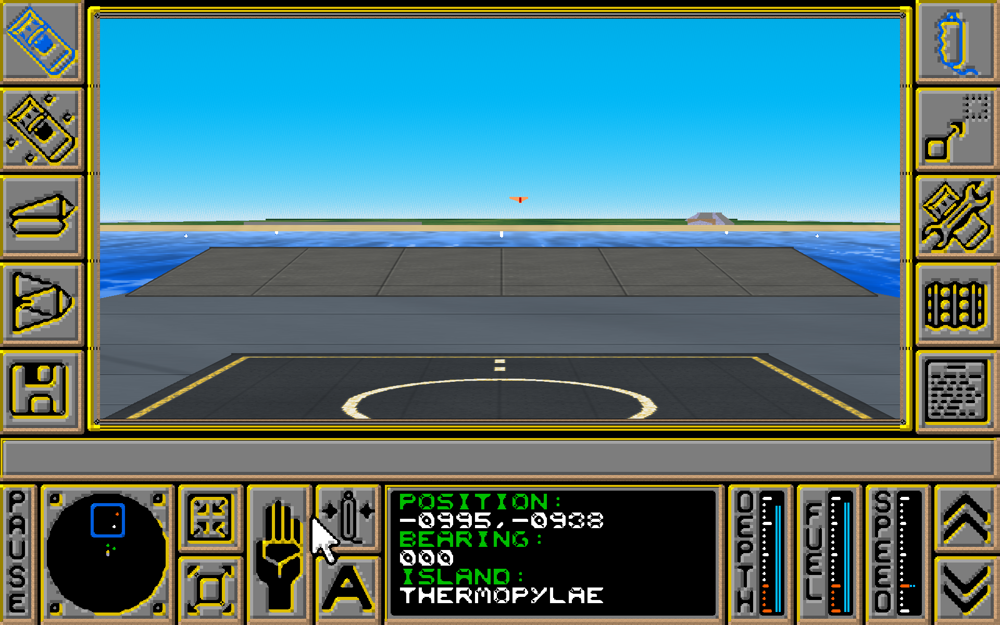
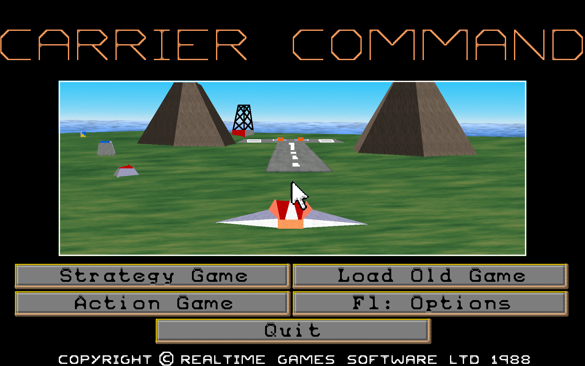

# Carrier Command for Windows 11

The 1989 DOS release of Carrier Command (v1.2, Realtime Games), running as a native Windows
program with a high-resolution renderer. DOSBox is not needed.

## You need the original game

This repository contains no game files. You need your own copy of the DOS release of Carrier
Command v1.2, specifically `CARRIER.EXE` and `CARRIER.DAT`. Put them in a `game` folder next to
`build.ps1` before building, or next to `CarrierCommand.exe` afterwards. Other versions of the
game have not been tested, and the renderer hooks fixed addresses in the v1.2 executable.

## Playing

Build it (see Building below), then run `dist\CarrierCommand.exe`. The `dist` folder is self-contained, so it can be moved anywhere.
At the first screen press **F1** for English (F2 German, F3 French).

| Key | Action |
| --- | --- |
| Mouse | Moves the game's cursor; left and right buttons click |
| Game keys | Passed straight to the game as PC scancodes |
| Arrows, Home, End, PgUp, PgDn | Behave as the numeric keypad |
| F11 | Switch between fullscreen and a window |
| F12 | Release or recapture the mouse (clicking the window also recaptures it) |
| Ctrl+T | Switch between the textured and flat looks |

Saved games are `.CCG` files in `dist\game`.

## Options

| Option | Default | Meaning |
| --- | --- | --- |
| `--windowed` | off | Start in a window |
| `--scale N` | 6 | Render at N x 320x200 (1 to 8); 6 is 1920x1200 |
| `--sens X` | 0.5 | Mouse sensitivity |
| `--classic` | off | Start with the flat look instead of textures |
| `--dither` | off | Keep the original dither patterns instead of blended colours |
| `--mips X` | 20 | Emulated CPU speed in millions of instructions per second |
| `--switches "..."` | `/V3 /I3 /C3` | The game's own switches: VGA, mouse, high detail |
| `--nograb` | off | Don't capture the mouse at startup |
| `--game DIR` | `game` next to the exe | Folder holding `CARRIER.EXE` and `CARRIER.DAT` |

Testing only: `--headless` runs without a window and `--script FILE` plays scripted input and
takes screenshots (see `tools\runtest.ps1`).

## How it works

- `src\cpu.c` is an 8086/80186 interpreter that runs the original `CARRIER.EXE`, including its
  EXEPACK unpacking stub. The game's code is not modified.
- `src\machine.c` provides the timer, keyboard and PC speaker hardware, and the DOS, BIOS and
  mouse services. DOS paths map onto the game folder, which appears to the game as drive C.
- `src\vga.c` emulates the planar EGA/VGA adapter. The game draws into this 320x200 image and
  reads it back, exactly as on real hardware.
- `src\hires.c` intercepts the game's polygon, line, circle, horizon and text routines and draws
  them at full resolution in a parallel copy of video memory. Other drawing is mirrored as smoothed
  blocks, and video-memory copies are copied at full detail.
- `src\textures.c` generates the world textures used by the default look. `surface_for` in
  `hires.c` chooses each face's material from the 3D model it belongs to and its game colour, so
  the carrier's flight deck, hull and plating never share a texture with islands. Terrain, rock,
  beach, concrete and carrier surfaces also get new colours from their own colour ramps.

## Known limits

- Polygon corners stay on the original 320x200 grid, so edges are sharp but shapes can still
  jitter slightly in motion.
- Textures are attached to each face's corners, not to world positions, so they can slide when
  the game clips a large face close to the camera, such as flying low over an island.
- Enemy models have not been checked for material mapping. Anything unrecognised falls back to
  the general metal and paint textures, with island materials chosen by game colour.
- Sound is the original PC speaker output.
- Bitmap art such as icons is smoothed from the originals, not redrawn.
- Only drive C exists, and changing directory in the game's file dialogs has no effect.

## Building

Run `powershell -File build.ps1`. It needs Visual Studio 2022 with the C++ tools; SDL2 is included
in `third_party`. Files in `tools` and `analysis` were used for reverse engineering and testing.
